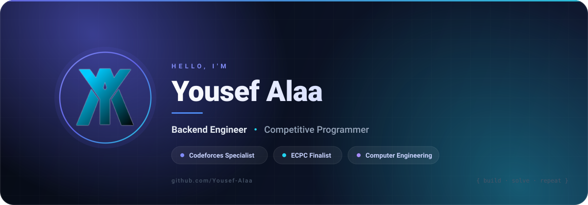
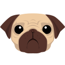
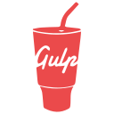

##  About me

Backend Engineer building reliable APIs and full-stack applications, with a competitive programmer's mindset for performance and clean logic.

- **Education** — Faculty of Engineering, Helwan University · Computers and Systems Department
- **Focus** — Backend engineering and full-stack web development
- **Competitive Programming** — Codeforces Specialist · ECPC Finalist

- **Website** — [yousef-alaa.netlify.app](https://yousef-alaa.netlify.app)

##  Skills

| Category | Technologies |
| :--- | :--- |
| **Languages** |        |
| **Frontend** |         |
| **Backend** |  <picture><source media="(prefers-color-scheme: dark)" srcset="assets/icons/express-white.svg" /></picture>   |
| **Databases** |     |
| **Messaging & Caching** |   |
| **DevOps & Tools** |  <picture><source media="(prefers-color-scheme: dark)" srcset="assets/icons/github-white.svg" /></picture>    |

##  Competitive Programming

- **Codeforces Specialist** — max rating **1441** ([Y.F.G.Y.Y](https://codeforces.com/profile/Y.F.G.Y.Y))
- **ECPC Finalist** — Egyptian Collegiate Programming Contest
- **Favourite topics** — Segment Trees, DSU, LCA / HLD, SCC / BCC, Mo's algorithm, DP, Number theory

> **[CP_Toolbox](https://github.com/Yousef-Alaa/CP_Toolbox)** — 50+ reusable C++ templates for data structures, graphs and trees, dynamic programming, number theory, strings and contest tricks.

##  Featured Projects

| Project | Stack | Description |
| :--- | :--- | :--- |
| **[CP_Toolbox](https://github.com/Yousef-Alaa/CP_Toolbox)** | C++ | My competitive-programming toolbox: 50+ battle-tested templates for data structures, graph algorithms, DP, math and strings. |
| **[SchnellPay-BackEnd](https://github.com/Yousef-Alaa/SchnellPay-BackEnd)** | Node.js · Express · SQL Server | Secure digital-wallet API with JWT refresh tokens and two-factor authentication. |
| **[Games-Wave](https://github.com/Yousef-Alaa/Games-Wave)** | React · Node.js · Express · MongoDB | Internet-cafe management system for PCs, PS4/PS5 sessions, market orders and automated billing. |

##  Education

- **Computer Engineering** — Faculty of Engineering, Helwan University, Computers and Systems Department
- **ECPC Finalist** — qualified for the Egyptian Collegiate Programming Contest finals
- **Codeforces Specialist** — reached Specialist rank with a maximum rating of 1441
- **Backend Engineer** — building production-style backend services and full-stack applications end to end

##  GitHub Stats

##  Let's Connect

&nbsp;&nbsp;&nbsp;
&nbsp;&nbsp;&nbsp;
<a href="https://github.com/Yousef-Alaa" title="GitHub">
  <picture><source media="(prefers-color-scheme: dark)" srcset="assets/icons/github-white.svg" /></picture>
</a>&nbsp;&nbsp;&nbsp;
&nbsp;&nbsp;&nbsp;

 
 

<a href="mailto:yousefnoureldien@proton.me">yousefnoureldien@proton.me</a> &nbsp;·&nbsp; <a href="https://yousef-alaa.netlify.app">yousef-alaa.netlify.app</a>

 

**والسَّلاَمُ عَلَيْكُمْ وَرَحْمَةُ اللهِ وَبَرَكَاتُهُ...**

